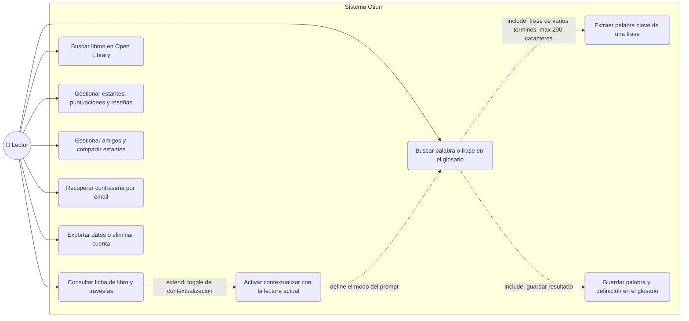
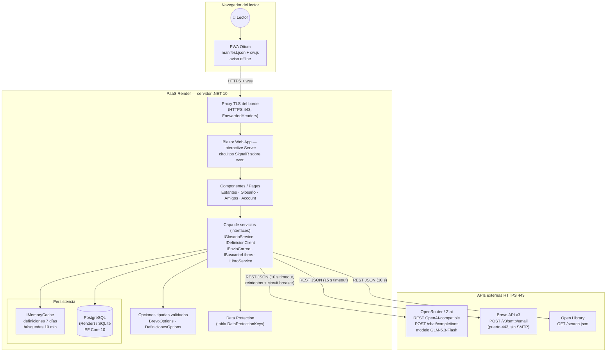
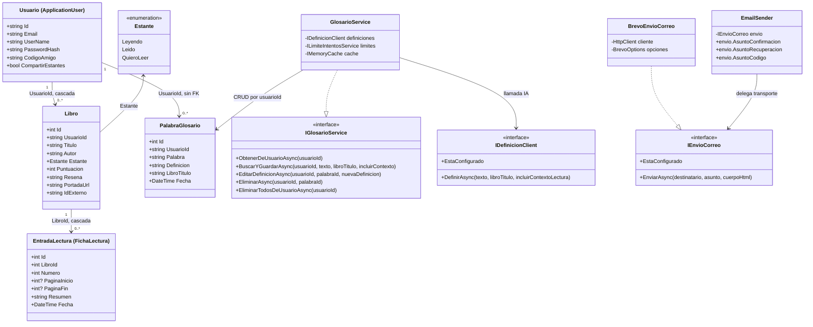
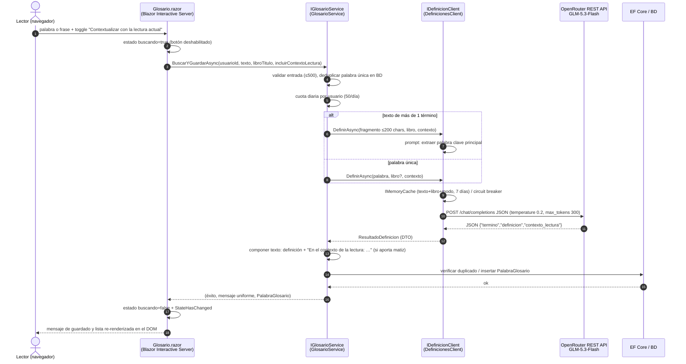

# Documento de requerimientos de software

**Otium — Diario de lectura y gestión de biblioteca personal**
Fecha: 28/10/2026

---

## Tabla de contenido

- [Historial de Versiones](#historial-de-versiones)
- [Información del Proyecto](#información-del-proyecto)
- [Aprobaciones](#aprobaciones)
- [1. Propósito](#1-propósito)
- [2. Alcance del producto / Software](#2-alcance-del-producto--software)
- [3. Referencias](#3-referencias)
- [4. Funcionalidades del producto](#4-funcionalidades-del-producto)
- [5. Clases y características de usuarios](#5-clases-y-características-de-usuarios)
- [6. Entorno operativo](#6-entorno-operativo)
- [7. Requerimientos funcionales](#7-requerimientos-funcionales)
- [8. Reglas de negocio](#8-reglas-de-negocio)
- [9. Requerimientos de interfaces externas](#9-requerimientos-de-interfaces-externas)
- [10. Requerimientos no funcionales](#10-requerimientos-no-funcionales)
- [11. Otros requerimientos](#11-otros-requerimientos)
- [12. Glosario](#12-glosario)
- [13. Bibliografías](#13-bibliografías)

---

## Historial de Versiones

| Fecha | Versión | Autor | Organización | Descripción |
|---|---|---|---|---|
| 28/10/2026 | 1.0 | Miguel (propietario) | Otium | Redacción inicial adaptada al estado beta privada del proyecto |
| 28/10/2026 | 1.1 | Miguel (propietario) | Otium | Añadido diagrama de clases (entidades y servicios principales) |
| | | | | |

---

## Información del Proyecto

| Campo | Valor |
|---|---|
| Empresa / Organización | Proyecto personal Otium |
| Proyecto | Otium — diario de lectura y biblioteca personal |
| Fecha de preparación | 28/10/2026 |
| Cliente | Uso personal (beta privada) |
| Patrocinador principal | Propietario del proyecto |
| Gerente / Líder de Proyecto | Propietario del proyecto |
| Gerente / Líder de Análisis y requerimientos | Propietario del proyecto |

---

## Aprobaciones

| Nombre y Apellido | Cargo | Departamento u Organización | Fecha | Firma |
|---|---|---|---|---|
| | | | | |
| | | | | |

---

## 1. Propósito

Este documento especifica los requerimientos de **Otium v1.x (beta privada)**: aplicación web de diario de lectura y biblioteca personal. Cubre la **totalidad del software**: aplicación web ASP.NET Core (Blazor), servicios de aplicación, integraciones externas (Open Library, servicio de definiciones IA y Brevo), persistencia (SQLite/PostgreSQL) y despliegue (Render / Tailscale / VPS).

## 2. Alcance del producto / Software

- **Propósito u objetivo general:** registrar la experiencia de lectura personal — estantes, travesías de lectura, glosario inteligente y dimensión social opcional — con bajo costo operativo y una interfaz íntegra en español.
- **Beneficios:** ahorro de costos frente a plataformas comerciales (Goodreads), privacidad por diseño (datos del usuario borrados y exportables, funciones sociales opt-in), definiciones de vocabulario por IA sub-segundo para lectura en español.
- **Objetivos y metas:** respuesta de definiciones en tiempo sub-segundo en aciertos de caché y acotada en fallo (timeout 10 s); disponibilidad de una app single-tenant pequeña sin requisitos de escalar horizontalmente; cero credenciales en el repositorio.
- Producto de referencia complementaria: `DOCS/ficha-tecnica.md` (arquitectura) y `AGENTS.md` (auditoría y convenciones).

## 3. Referencias

| Título | Autor/Origen | Versión/Fecha | Ubicación |
|---|---|---|---|
| Ficha técnica de Otium | Proyecto Otium | 2026-10-28 | `DOCS/ficha-tecnica.md` |
| AGENTS.md (auditoría y convenciones) | Proyecto Otium | 2026-10-23 | `AGENTS.md` (raíz del repo) |
| Procedimiento de respaldos | Proyecto Otium | 2026-10-25 | `DOCS/respaldos.md` |
| Open Library Search API | Open Library | vigente | https://openlibrary.org/developers/api |
| OpenRouter API (OpenAI-compatible) | OpenRouter | vigente | https://openrouter.ai/docs |
| Brevo API v3 — Transactional emails | Brevo | vigente | `POST https://api.brevo.com/v3/smtp/email` |

## 4. Funcionalidades del producto

1. **Registro e inicio de sesión** (ASP.NET Core Identity, lockout, rate limiting).
2. **Estantes personales** (Leyendo / Leído / Quiero Leer) con libros, portadas, puntuación 1–5 y reseñas.
3. **Búsqueda de libros en Open Library** con caché, reintentos y portadas.
4. **Travesías de lectura** (entradas con páginas y resumen por libro, numeradas).
5. **Glosario inteligente** con definiciones IA (GLM-5.3-Flash vía API REST), contextualización con la lectura actual y estado persistente en la app.
6. **Notificaciones y emailing transaccional** (recuperación de contraseña vía API REST de Brevo).
7. **Dimensión social opt-in**: amigos por código, compartir estantes, eliminar, bloquear.
8. **Cuenta**: exportación JSON y eliminación transaccional.
9. **Tema claro/oscuro, PWA instalable, health `/health`, telemetría Sentry opcional.**

> El detalle por requerimiento se documenta en la sección 7 (prioridad, acciones iniciadoras y REQ con identificador).

### Diagrama de casos de uso

## 5. Clases y características de usuarios

| Clase | Descripción | Funcionalidades relevantes |
|---|---|---|
| **Lector (usuario registrado)** | Uso frecuente: responde al propietario y a un grupo pequeño de beta-testers. Autenticado con Identity, español como idioma único de la UI. | Todas (estantes, glosario, travesías, amigos, cuenta). |
| **Usuario anónimo** | Visitante ocasional. | Acceso público mínimo: privacidad, términos, soporte, login/registro. |
| **Administrador/operador** | El propio propietario desde el panel del PaaS. | Variables de entorno, respaldos, sentry, logs de diagnóstico (`DiagnosticoConfiguracion`). |

## 6. Entorno operativo

- **Aplicacíon:** ASP.NET Core `net10.0`, Blazor Web App en **Interactive Server** (circuito SignalR vía WebSocket `wss:`; no se usa WebAssembly).
- **Despliegue principal:** PaaS **Render**; Kestrel en loopback detrás del proxy TLS del borde (`ForwardedHeaders` + `ASPNETCORE_FORWARDEDHEADERS_ENABLED=true`); HTTPS exigido en `Production`.
- **Despliegues secundarios:** Tailscale local (`Seguridad__PermitirHttp=true`) y VPS Oracle con Caddy/Nginx.
- **Datos:** EF Core 10 con **SQLite** (local/Docker) o **PostgreSQL** (Render, detección por formato de cadena; esquema vía `EnsureCreated` controlado).
- **Coexistencia:** APIs externas HTTPS 443 — OpenRouter (GLM), Brevo y Open Library; puertos SMTP salientes **no** se utilizan (bloqueados en PaaS).

### Diagrama de arquitectura / componentes

### Diagrama de clases (entidades y servicios principales)

Representa el modelo real del código fuente: `ApplicationUser` (Usuario de Identity),
`Libro`, `EntradaLectura` (los "travesías"/fichas de lectura), `PalabraGlosario` (glosario)
y los contratos de servicio `GlosarioService` e `EmailSender` (con su transporte
`BrevoEnvioCorreo`). Las cardinalidades reflejan las FK de `ApplicationDbContext`
(cascada de usuario→libros y libro→travesías; `PalabraGlosario` se filtra por
`UsuarioId` sin FK).

## 7. Requerimientos funcionales

Los requerimientos se organizan por funcionalidad de producto. Formato: descripción, prioridad, acciones iniciadoras y comportamiento esperado, y lista de requerimientos `REQ-XX-n`.

### 7.1 Glosario inteligente con IA

**Descripción:** el lector consulta palabras o frases y guarda la definición en su glosario personal; opcionalmente el servicio contextualiza la definición con la ficha/libro actual ("Contextualizar con la lectura actual").

**Prioridad:** alta.

**Acciones iniciadoras y comportamiento esperado:**
1) el lector escribe una palabra o frase y pulsa Buscar (o Enter); 2) la UI entra en estado `buscando` (botón deshabilitado, spinner textual) mientras el circuito interactivo mantiene el resto de la página; 3) el servicio valida entrada, descarta duplicados por vía rápida en BD, comprueba la cuota diaria y consulta el modelo vía REST; 4) si el texto es una frase larga (más de 1 término), el **prompt instruye al modelo extraer automáticamente la palabra clave principal**; el texto se recorta a **200 caracteres** antes de enviarlo; 5) la respuesta llega como **DTO** (`ResultadoDefinicion`: término, definición global, contexto opcional) y se compone el texto final; 6) la UI actualiza el DOM re-renderizando solo la lista.

Diagrama de secuencia del caso principal:

**Requerimientos funcionales:**

- **REQ-GLM-1:** el servicio debe aceptar tanto una palabra única como una frase; en frases de más de 1 término, el modelo debe extraer y devolver el término principal (`termino`), que es el que se guarda en el glosario.
- **REQ-GLM-2:** el texto enviado al modelo debe recortarse a 200 caracteres máximo para no desperdiciar tokens (la validación de entrada del servicio admite hasta 500).
- **REQ-GLM-3:** el toggle "Contextualizar con la lectura actual" debe activar el modo con contexto solo cuando exista una ficha de libro activa; el prompt incluye el libro y solicita `contexto_lectura` (máx. 20 palabras) **solo si aporta un matiz relevante**; si no, cadena vacía y la definición se guarda sin la frase "En el contexto de la lectura:".
- **REQ-GLM-4:** el proveedor debe ser una API **REST OpenAI-compatible** (OpenRouter/Z.ai) con el modelo **GLM-5.3-Flash**, autenticación `Bearer <ApiKey>` sobre HTTPS y endpoint/modelo configurables sin recompilar.
- **REQ-GLM-5:** el tiempo de respuesta percibido debe ser ultrarrápido (objetivo sub-segundo): respuestas concisas (`max_tokens=300`, definición de 15–20 palabras guiadas por prompt), caché en memoria de 7 días por texto+libro+modo y deduplicación en BD *antes* de gastar cuota o API.
- **REQ-GLM-6:** fallos del modelo (timeout 10 s, 2 reintentos acotados, circuit breaker, JSON inválido, respuesta vacía o HTTP 4xx/5xx) degradan a mensaje amigable en español sin exponer detalles técnicos.
- **REQ-GLM-7:** toda palabra/definición queda asociada al `usuarioId` con cuota de 50 consultas/día; los duplicados no consumen segunda llamada del modelo y se informan con mensaje uniforme ("Ya está en tu glosario.").
- **REQ-GLM-8:** la interfaz Blazor debe gestionar el estado de forma eficiente durante la llamada (`buscando`, deshabilitar el botón, mensajes de éxito/error) y re-renderizar la lista sin recargar la página (circuito SignalR persistente, actualizaciones parciales del DOM).

### 7.2 Emailing transaccional

**Descripción:** envío de correos transaccionales (recuperación de contraseña) mediante **API REST de Brevo** en lugar de SMTP tradicional.

**Prioridad:** alta.

**Acciones iniciadoras y comportamiento esperado:** el lector solicita recuperar su contraseña; el servicio genera el enlace con `Sitio:UrlPublica`, delega en `IEnvioCorreo` y `BrevoEnvioCorreo` realiza `POST https://api.brevo.com/v3/smtp/email` (HTTPS 443) con cabecera `api-key`, cuerpo JSON `sender/to/subject/htmlContent`, timeout 15 s y cancelación; el resultado de envío se registra en logs sin romper la petición y la UI muestra siempre una respuesta uniforme.

**Requerimientos funcionales:**

- **REQ-COR-1:** todos los correos deben enviarse por la **API REST de Brevo sobre HTTP/HTTPS en el puerto 443**; queda prohibido el transporte SMTP saliente (25/465/587), bloqueado por diseño en PaaS como Render.
- **REQ-COR-2:** la autenticación debe usar la API key v3 (`xkeysib-…`) en la cabecera `api-key`; la key no se registra ni se devuelve en los errores.
- **REQ-COR-3:** el remitente debe ser `Brevo:SenderEmail` verificado en Brevo con nombre `Brevo:SenderName`; el asunto y cuerpo (`htmlContent`) provienen de plantillas centralizadas en `EmailSender`.
- **REQ-COR-4:** la petición de envío debe tener timeout de 15 s, `CancellationToken` y captura del código/mensaje HTTP sin interrumpir el flujo del usuario; los errores se registran con detalle acotado.
- **REQ-COR-5:** la solicitud de recuperación debe responder de forma uniforme independientemente de si el correo existe (anti-enumeración) y solo enviar el enlace en esa operación.

### 7.3 Registro, sesión y protección de cuenta

**Prioridad:** alta. **Requerimientos:**

- **REQ-REG-1:** registro con correo+contraseña (mín. 8 caracteres, mayúscula, minúscula y número), asignación criptográfica de `CodigoAmigo` (8 caracteres) con reintentos ante colisiones, sin exigir confirmación de correo (flujo "Opción B").
- **REQ-REG-2:** lockout por intentos fallidos y rate limiting HTTP por IP en login (10/min), registro y recuperación.
- **REQ-REG-3:** recuperación de contraseña funcional para todas las cuentas existentes, con enlaces construidos con `Sitio:UrlPublica`.
- **REQ-REG-4:** el llavero de Data Protection debe sobrevivir a redeploys (tabla `DataProtectionKeys` o `DataProtection__KeysPath`).

### 7.4 Biblioteca y travesías

**Prioridad:** alta. **Requerimientos:**

- **REQ-LIB-1:** CRUD de libros por usuario con estantes (enum persistido), puntuación 0–5 validada y reseña con longitud acotada; búsquedas contra Open Library con 8 resultados, caché 10 min y mensajes amigables en fallo.
- **REQ-LIB-2:** travesías (entradas de lectura) con páginas ordenadas y no negativas, vinculadas a libros del propietario y eliminadas en cascada.
- **REQ-LIB-3:** todo servicio valida que el recurso pertenezca al `usuarioId` de la sesión (anti-IDOR), probado con dos usuarios.

### 7.5 Cuenta, privacidad y operación

**Prioridad:** media. **Requerimientos:**

- **REQ-CTA-1:** exportación JSON completa (libros, travesías, glosario, amistades) y eliminación de cuenta transaccional en un único flujo con confirmación de la contraseña.
- **REQ-CTA-2:** función social opt-in (`CompartirEstantes` por defecto off; los amigos solo ven libros, puntuaciones y reseñas), con eliminar amigo y bloqueo/desbloqueo.
- **REQ-OPS-1:** health check `/health` (comprobación de BD), respaldos con retención 5 y verificación de integridad, y telemetría Sentry activa solo si `Sentry:Dsn` está configurado.

## 8. Reglas de negocio

- **RN-1 — Privacidad por defecto:** travesías y glosario siempre privados; el estante solo se comparta si el usuario lo activa explícitamente.
- **RN-2 — Cuota de IA:** máximo 50 definiciones/día por usuario; la definición de duplicados existentes no consume llamada al modelo.
- **RN-3 — Menor costo de tokens:** entradas ≤200 caracteres al proveedor, `max_tokens=300`, definiciones guiadas por prompt de 15–20 palabras.
- **RN-4 — Anti-enumeración:** mensajes uniformes ante recursos inexistentes o ajenos (amistades, recuperación de contraseña).
- **RN-5 — Sin secretos en el código:** claves solo por entorno/User Secrets; validación fail-fast al arranque (`DiagnosticoConfiguracion` registra presencia/longitud, nunca contenido).
- **RN-6 — Traducción:** la interfaz y los mensajes de dominio están íntegramente en español.

## 9. Requerimientos de interfaces externas

### 9.1 Interfaces de usuario

- Blazor Web App con renderizado interactivo por servidor; componentes Razor con CSS aislado por componente (`.razor.css`).
- Guías de estilo: UI cuidada en español, tema claro/oscuro (`tema.js`), botones/estados coherentes (disabled + spinner textual mientras `buscando`), PWA instalable con aviso sin conexión.
- El servicio de definiciones está pensado para mostrar resultados desde una ficha/formulario con estados diferenciados de éxito y error.

### 9.2 Interfaces de hardware

- Navegadores de escritorio y móviles modernos (PWA); sin interacción con impresoras ni hardware especializado. HTTPS obligatorio en `Production` y CSP con `wss:` para el circuito SignalR.

### 9.3 Interfaces de software

| Interface | Implementación | Formato | Seguridad |
|---|---|---|---|
| OpenRouter / Z.ai — `POST {endpoint}/chat/completions` | DefinicionesClient | JSON OpenAI-compatible (`model`, `messages`, `temperature`, `max_tokens`) → `choices[0].message.content` con objeto `{"termino","definicion","contexto_lectura"}` | `Authorization: Bearer Definiciones:ApiKey` |
| Brevo API v3 — `POST /v3/smtp/email` | BrevoEnvioCorreo | JSON `sender/to/subject/htmlContent` | header `api-key: Brevo:ApiKey` |
| Open Library — `GET /search.json` | BuscadorLibros | JSON con caché 10 min, `User-Agent: Otium/1.0` | n/a |
| BD — EF Core 10 | Servicios de aplicación | Relacional (SQLite/PostgreSQL) | Cadena de conexión por entorno; `SslMode=Require` en Postgres |

### 9.4 Interfaces de comunicación

- **Entrada de usuario:** HTTPS 443 + WebSocket `wss:` (SignalR) detrás del proxy del PaaS; `ForwardedHeaders` confía en proxies conocidos.
- **Salidas:** REST JSON sobre HTTPS/443 a OpenRouter, Brevo y Open Library. Formatos JSON UTF-8; no se usan FTP ni otros protocolos. Requisitos de cifrado: TLS obligatorio a todos los servicios externos, cabeceras de seguridad (CSP, nosniff, frame-ancestors) y cookies `Secure`/`HttpOnly` en `Production`.
- **Email:** mediante REST (sección 7.2); no hay puertos SMTP salientes.

## 10. Requerimientos no funcionales

| REQ-NF | Categoría | Requisito |
|---|---|---|
| REQ-NF-1 | Rendimiento | Definiciones percibidas sub-segundo en aciertos de caché como objetivo; en cualquier caso dentro del timeout de 10 s; llamadas HTTP asíncronas (`async/await`) que nunca bloquean el hilo. |
| REQ-NF-2 | Resiliencia | Reintentos acotados (2) con espera de 300/200 ms, circuit breaker propio y propagación de `CancellationToken` en toda I/O externa. |
| REQ-NF-3 | Seguridad | Cero secretos en el repositorio (`appsettings.Development.json` ignorado por Git; `dotnet publish` sin BD de desarrollo); validación de entrada (DataAnnotations + validadores en servicios); rate limiting por IP/ruta; antiforgery. |
| REQ-NF-4 | Calidad | Compilación Release sin errores ni warnings; 36+ pruebas xUnit con `WebApplicationFactory` sobre SQLite temporal y cobertura ≥70 % de líneas en CI. |
| REQ-NF-5 | Operación | Health `/health`; respaldos automáticos (retención 5); logs de diagnóstico que no filtran claves; Sentry opcional. |
| REQ-NF-6 | Mantenibilidad | Interfaces para todo servicio, opciones tipadas validadas al arranque, DTOs en frontera externa, diagramas y docs actualizados con cada cambio de arquitectura. |
| REQ-NF-7 | Escalabilidad | Alcance consciente: single-tenant con SQLite/Blazor Server; PostgreSQL si se requiere crecer; no es objetivo escalar horizontalmente. |

## 11. Otros requerimientos

- **Bases de datos:** migraciones EF para SQLite no portables a PostgreSQL; en Render el esquema se crea con `EnsureCreated` controlado y el arranque reintenta 5 veces deteniendo la app si no hay BD.
- **Legal/privacidad:** políticas de privacidad, términos, `robots.txt` y `security.txt` publicados; eliminación de cuenta garantiza borrado completo de datos personales.
- **Internacionalización:** español como único idioma soportado oficialmente; quedan restos aceptados de Identity scaffold.
- **Reuso:** sin dependencias nuevas salvo existentes; ASP.NET Core como plataforma completa.

## 12. Glosario

| Término | Descripción |
|---|---|
| **Travesía** | Entrada de lectura asociada a un libro con páginas y resumen (nombre propio del dominio Otium). |
| **Glosario inteligente** | Diccionario personal con definiciones generadas por IA y contexto de lectura opcional. |
| **Contexto de lectura** | Matiz situacional de un término aplicado al libro indicado ("En el contexto de la lectura: …"). |
| **DTO** | Objeto de transferencia de datos; `ResultadoDefinicion(Termino, Definicion, ContextoLectura)`. |
| **Circuit breaker** | Patrón que aísla fallos repetidos de un servicio externo (estados cerrado/abierto/medio-abierto). |
| **Rate limiting** | Limitación de tasa de peticiones por IP y cuotas por usuario (particiones de ventana fija). |
| **PaaS** | Plataforma como servicio (Render); los puertos SMTP salientes están bloqueados. |
| **Blazor Interactive Server** | Modalidad de Blazor donde la UI se ejecuta en el servidor y se comunican por SignalR/WebSocket. |
| **OpenRouter** | Pasarela REST OpenAI-compatible que expone modelos como GLM-5.3-Flash. |
| **Brevo** | Proveedor de email transaccional consumido vía API v3 REST. |
| **EF Core** | ORM oficial de .NET para el acceso a datos. |
| **IDOR** | Referencia directa insegura de objetos: mitigada filtrando cada consulta por `usuarioId`. |

## 13. Bibliografías

1. Microsoft. *ASP.NET Core Blazor documentation*. learn.microsoft.com/aspnet/core/blazor (consultada 2026-10-28).
2. Microsoft. *EF Core 10 documentation*. learn.microsoft.com/ef/core.
3. OpenRouter. *Quickstart — OpenAI SDK compatibility*. openrouter.ai/docs.
4. Brevo. *API Reference — Transactional Email v3*. developers.brevo.com.
5. Open Library. *Search API*. openlibrary.org/developers/api.
6. Fowler, M. *Patterns of Enterprise Application Architecture*. Addison-Wesley, 2002.
